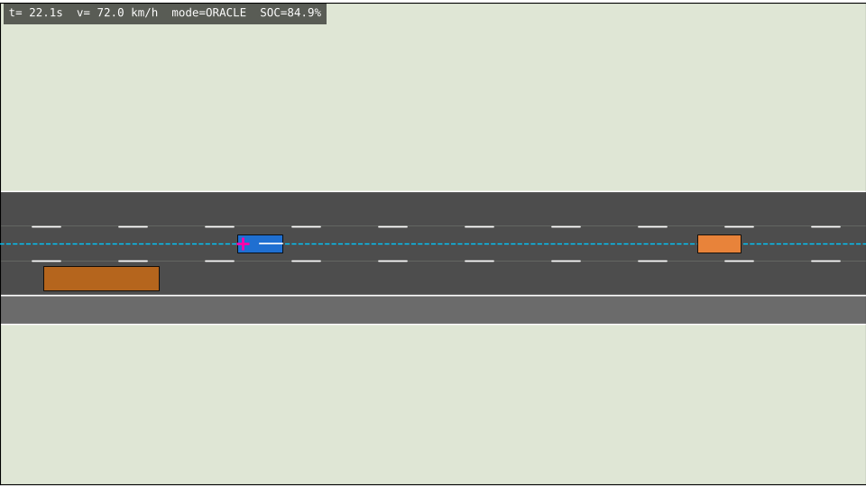
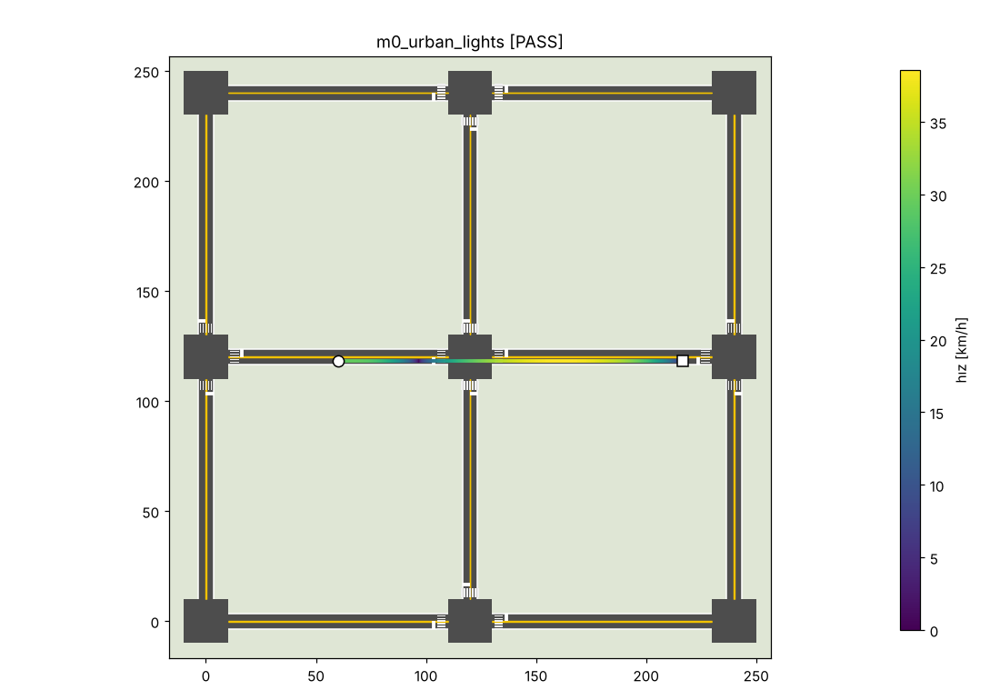
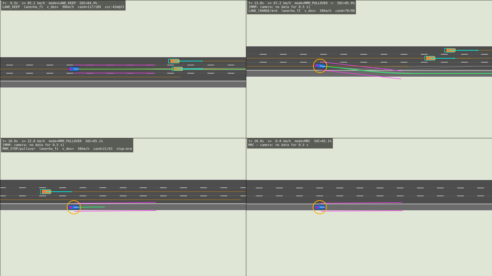
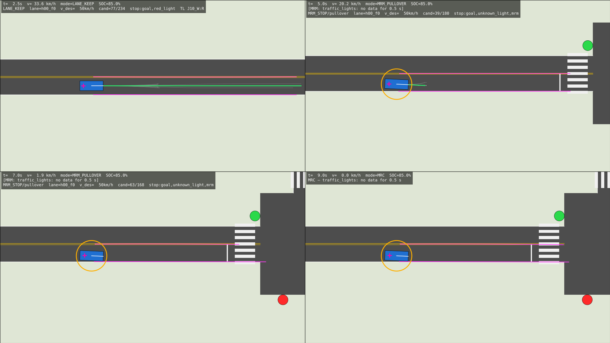

# Moga Otonom – Seviye 4 Otonom Sürüş Yazılımı

Moga elektrikli otonom aracı için sıfırdan yazılmış **SAE Seviye 4** otonom
sürüş yazılımı ve onu sürekli test etmek için geliştirilen **MogaSim**
simülasyon ortamı.

Geliştirme milestone mantığıyla ilerler; her milestone sonunda simülasyonda
kapalı çevrim çalışan bir prototip ve otomatik testler bulunur.
Yol haritası ve durum: [`docs/MILESTONES.md`](docs/MILESTONES.md) ·
Mimari: [`docs/ARCHITECTURE.md`](docs/ARCHITECTURE.md) ·
Güvenlik konsepti: [`docs/SAFETY.md`](docs/SAFETY.md) ·
Senaryo raporu: [`docs/SCENARIO_REPORT.md`](docs/SCENARIO_REPORT.md) ·
Gerçek veri ve MetaDrive: [`docs/REAL_DATA.md`](docs/REAL_DATA.md)

## Yetenekler (özet)

* **Lokalizasyon**: GNSS (RTK/DGPS/SPS) + IMU + teker odometrisi EKF, kamera şerit
  ölçümleriyle şerit‑göreli düzeltme, tünelde ölü hesap.
* **Algılama**: kamera ile şerit algılama (çizgi tipi dahil), LiDAR nesne algılama
  (zemin ayrıştırma, kümeleme, L‑shape, sınıflandırma), radar füzyonu, çoklu nesne takibi,
  şerit grafı tabanlı tahmin, trafik ışığı durum kestirimi.
* **Planlama**: GPS görevinden şerit seviyesinde rota, davranış durum makinesi (ACC, şerit
  değiştirme, sollama, sağdan gitme, engel geçişi/bypass), Frenet kafes planlayıcı,
  trafik kuralları (ışık, sarı ikilemi, yaya geçidi, kavşak yol hakkı).
* **Güvenlik (L4)**: bağımsız AEB, sağlık ve ODD izleme, degrade modlar, MRM ile emniyet
  şeridine / kenara çekilip durma, MRC, olay veri kaydı (EDR).
* **Doğrulama**: MogaSim'de 38 kapalı çevrim senaryo + hata enjeksiyonu, deterministik
  tekrar, CI.
* **Gerçek veri / bağımsız simülatör (M7)**: kalibre sensör takımı modeli, gerçek
  Velodyne + kamera kaydında (KITTI raw) açık çevrim algılama ölçümü, açık kaynak
  MetaDrive simülatöründe kapalı çevrim sürüş.

## Neden kendi simülatörümüz?

CARLA / LGSVL gibi simülatörler GPU ve ağır kurulum gerektirir; CI içinde,
headless ve deterministik koşamaz. MogaSim:

* saf Python + NumPy/SciPy, GPU gerektirmez, gerçek zamandan hızlı çalışır,
* her koşu tohumla (seed) tekrarlanabilir → regresyon testi yapılabilir,
* sensörleri ham veri seviyesinde modeller (GNSS lat/lon, IMU, LiDAR nokta
  bulutu, kamera görüntüsü, radar) – otonomi yığını yer gerçeğini göremez,
* hata enjeksiyonu (sensör kaybı, GNSS kesintisi, aktüatör arızası, hava) ile
  Seviye 4 geri dönüş davranışlarını test etmeye olanak verir.

Otonomi yığını simülatörden bağımsızdır; mesaj arayüzü ROS 2 tiplerine
benzer şekilde tasarlandı, böylece ileride ROS 2 / gerçek araç donanımına
köprülenebilir.

## Kurulum

Kendi bilgisayarınızda çalıştırmak için adım adım kılavuz (Windows / macOS /
Linux, tek komutla kurulum + demo, canlı izleme, MetaDrive): **[`KURULUM.md`](KURULUM.md)**

```bash
pip install -r requirements.txt
```

## Kullanım

```bash
# senaryoları listele
python scripts/run_scenario.py --list

# bir senaryoyu pencerede canlı izle
python scripts/run_scenario.py m5_urban_mission --live

# tek senaryo + GIF / genel bakış görseli
python scripts/run_scenario.py m1_urban_route --gif out/urban.gif --overview out/urban.png

# bir milestone'un tüm senaryoları + rapor
python scripts/run_scenario.py --milestone M0 --driver oracle --report out/report.md

# dokümantasyon görseli: seçilen anlardaki kareler
python scripts/make_figures.py m4_rural_bypass 16 30.6 31.8 33.4 --columns 2 --view 70 -o out/bypass.png

# testler (paralel)
python -m pytest -q -n 4

# gerçek kayıt (KITTI raw, ayrıca indirilir): algılama değerlendirmesi + görseller
python scripts/replay_kitti.py --root /data/kitti --drives 5 15 --figures 150 --out out/kitti

# MetaDrive'da kapalı çevrim (ayrı Python 3.11 ortamı: requirements-metadrive.txt)
.venv-metadrive/bin/python scripts/run_metadrive.py --seeds 0 1 2 3 --map 3 --plot --out out/metadrive
```

## Durum

| Milestone | Durum |
|-----------|-------|
| M0 – Simülatör çekirdeği | ✅ |
| M1 – Lokalizasyon + GPS tabanlı sürüş | ✅ |
| M2 – Kamera şerit algılama + şerit takibi | ✅ |
| M3 – LiDAR/radar algılama + nesne takibi | ✅ |
| M4 – Davranış + hareket planlama (şerit değiştirme, sollama, AEB) | ✅ |
| M5 – Şehir içi sürüş (kavşak, ışık, yaya) | ✅ |
| M6 – Seviye 4 güvenlik (arıza, ODD, MRM) | ✅ |
| M7 – Gerçek sensör verisi (KITTI) + bağımsız simülatör (MetaDrive) | ✅ |

## Görseller

| M0 – otoyol trafiği (oracle) | M0 – sinyalize şehir ızgarası |
|---|---|
|  |  |
| **M1 – GPS görevi, şerit seviyesinde rota** | **M1 – tünelde ölü hesap (GNSS yok)** |
|  |  |
| **M2 – kamera şerit algılama (çift sarı çizgi)** | **M2 – standart GPS: kamera füzyonu ile/olmadan** |
|  |  |
| **M3 – LiDAR/radar nesne takibi + tahmin** | **M3 – ACC dur‑kalk** |
|  |  |
| **M4 – boşluk bekle, sollama, sağa dönüş** | **M4 – karşı trafiği bekleyip engeli geçme** |
|  |  |
| **M5 – şehir içi GPS görevi (ışık, yaya, bypass)** | **M5 – yaya geçidinde yol verme** |
|  |  |
| **M6 – kamera arızası: emniyet şeridine çekilme (MRM → MRC)** | **M6 – ışık algılayıcı arızası: kenara çekilme** |
|  |  |
| **M7 – MetaDrive (bağımsız simülatör): döner kavşak + kavşak, 528 m** | |
|  | |

## Araç varsayımları

Gerçek Moga parametreleri `moga/common/vehicle_params.py` içinde tek yerde
toplanmıştır (boyutlar, kütle, lastik, direksiyon/fren aktüatörleri, 150 kW
motor, 60 kWh batarya, sensör montaj konumları). Gerçek ölçümler geldiğinde
bu dosya güncellenmelidir.
