# Moga Otonomi – Milestone Yol Haritası

Her milestone sonunda **çalışan bir prototip** çıkar: kod + otomatik testler +
MogaSim'de kapalı çevrim (closed-loop) koşan senaryolar + görsel çıktı.
Bir milestone, kendi kabul kriterleri ve **önceki tüm milestone testleri**
yeşilken tamamlanmış sayılır (regresyon koruması).

| # | Milestone | Kapsam | Prototip / Demo | Durum |
|---|-----------|--------|-----------------|-------|
| M0 | Simülatör çekirdeği (MogaSim) | HD harita modeli, harita kütüphanesi, dinamik bisiklet araç modeli + EV güç aktarma/batarya, IDM trafik, yayalar, trafik ışıkları, metrikler, görselleştirme, senaryo koşucusu | Referans (oracle) sürücü otoyol / pist / şehir senaryolarını kazasız sürer | ✅ |
| M1 | Lokalizasyon + GPS tabanlı otonom sürüş | GNSS/IMU/teker odometrisi sensör modelleri, WGS‑84↔ENU, EKF füzyonu, GPS görev (lat/lon) → şerit seviyesinde rota (A*), pure‑pursuit + PID | Araç yalnızca sensör verisiyle GPS hedeflerine gider | ✅ |
| M2 | Kamera ile şerit algılama + şerit takibi | Kamera sensör modeli, IPM, sırt (ridge) filtresi, kayan pencere, polinom uydurma, zamansal filtre, Stanley kontrolcü, şerit‑göreli lokalizasyon düzeltmesi | Virajlı yolda kamera tabanlı şerit takibi, GNSS kesintisinde şeritle konum düzeltme | ✅ |
| M3 | LiDAR/Radar algılama + çoklu nesne takibi | Işın izleme LiDAR, radar, zemin ayrıştırma (RANSAC), harita ROI, kümeleme, L‑shape kutu uydurma, sınıflandırma, KF + Macar algoritması ile takip, radar füzyonu, şerit tabanlı tahmin | Trafik içinde nesneler tespit/takip edilir, ACC ile takip | ✅ |
| M4 | Davranış + hareket planlama | Davranış durum makinesi, Frenet kafes (lattice) planlayıcı, çarpışma kontrolü, ACC, şerit değiştirme, sollama, engelden kaçınma, araya girme (cut‑in), AEB | Otoyolda sollama / şerit değiştirme / acil fren senaryoları | ✅ |
| M5 | Şehir içi sürüş | Kavşak bağlayıcıları, trafik ışığı algılama, stop çizgisi, yaya geçidi, yayalara yol verme, kavşak çatışma kontrolü, kentsel GPS görevi | Sinyalize grid üzerinde A noktasından B noktasına otonom sürüş | ✅ |
| M6 | Seviye 4 güvenlik | Sağlık izleme, ODD izleme, hata enjeksiyonu, degrade modlar, Minimum Risk Manevrası (emniyet şeridine çekilip durma), olay veri kaydedici (EDR), tam senaryo seti + CI | Sensör/aktüatör arızasında araç kendini güvenli duruma getirir | ⏳ |

## Seviye 4 (SAE J3016) gereksinimlerinin karşılanması

SAE Seviye 4: tanımlı bir **Operasyonel Tasarım Alanı (ODD)** içinde sürüş
görevinin tamamını ve **geri dönüş (fallback)** görevini sistem üstlenir;
insan sürücüye devretme beklenmez.  Bunun yazılımdaki karşılıkları:

| L4 gereksinimi | Modül | Milestone |
|----------------|-------|-----------|
| Kendi konumunu bilmek (şerit seviyesi) | `autonomy/localization` (EKF, şerit düzeltmesi) | M1, M2 |
| Çevresini algılamak (şerit, araç, yaya, engel, ışık) | `autonomy/perception`, `autonomy/tracking` | M2, M3, M5 |
| Diğer katılımcıların davranışını öngörmek | `autonomy/prediction` | M3 |
| Görev / rota planlama (GPS hedefi) | `autonomy/planning/route_planner` | M1, M5 |
| Trafik kurallarına uyum (hız, ışık, yol hakkı) | `autonomy/planning/behavior` | M4, M5 |
| Güvenli ve konforlu yörünge | `autonomy/planning/frenet` | M4 |
| Araç kontrolü | `autonomy/control` | M1, M2 |
| Bağımsız acil fren katmanı | `autonomy/safety/aeb` | M4 |
| Arıza tespiti ve degrade çalışma | `autonomy/safety/health` | M6 |
| ODD dışına çıkışı algılama | `autonomy/safety/odd` | M6 |
| Sürücüsüz geri dönüş: Minimum Risk Durumu | `autonomy/safety/mrm` | M6 |
| Olay kaydı / denetlenebilirlik | `autonomy/safety/edr` | M6 |

## M1 – Lokalizasyon ve GPS tabanlı sürüş (tamamlandı)

**Sensör modelleri** (`moga/sim/sensors`)
* GNSS: RTK‑fixed / RTK‑float / DGPS / SPS modları; Gauss‑Markov korelasyonlu hata +
  beyaz gürültü, çok yollu yansıma (multipath) aykırı değerleri, kapsama dışı bölgeler
  (tünel), Doppler hız, WGS‑84 çıktı.
* IMU: ivme / açısal hız gürültüsü, sabit + rastgele yürüyüş bias.
* Teker odometrisi: lastik yarıçap (ölçek) hatası, gürültü, direksiyon açısı.

**Otonomi** (`moga/autonomy`)
* `localization/ekf.py` – 7 durumlu EKF: konum, yönelim, hız, gyro bias, ivme bias,
  odometri ölçek faktörü. GNSS anten kaldıraç kolu, Doppler hız, teker hızı,
  duruşta sıfır‑hız güncellemesi (ZUPT), Mahalanobis (χ²) aykırı değer reddi,
  Joseph formu kovaryans güncellemesi.
* `planning/route_planner.py` – şerit grafında A*: ardıl bağlantılar, kesikli çizgide
  şerit değiştirme kenarları, kavşak dönüş maliyetleri, kapalı pistte tur.
  GPS (lat/lon) görev noktaları → şerit + yay uzunluğu.
* `planning/route_path.py` – rotadan referans yol (şerit değişimleri 5. derece
  geçişlerle), hız limiti / eğrilik / hedefte durma hız profili.
* `control/controllers.py` – Stanley (ön aks, eksik yönlenme telafisi, yaw sönümleme),
  pure pursuit, PID + ileri besleme + sarsıntı (jerk) sınırlı boylamsal kontrol.

**Senaryolar ve sonuçlar** (`python scripts/run_scenario.py --milestone M1`)

| Senaryo | İçerik | Sonuç (seed 0) |
|---|---|---|
| `m1_gps_loop_rtk` | Oval pistte 3 GPS hedefli görev + şerit değiştirme | lok. RMSE 0.02 m, şerit RMS 0.04 m |
| `m1_rural_rtk` | Virajlı kırsal yolda GPS hedefi | lok. RMSE 0.02 m |
| `m1_urban_route` | Şehir ızgarasında dönüşlü rota, 2 ara hedef | lok. RMSE 0.02 m |
| `m1_highway_tunnel` | 90 km/h'te 350 m tünel (GNSS yok) | maks. hata < 0.6 m (6 tohum) |
| `m1_rural_multipath` | RTK‑float + %5 çok yollu yansıma (8 m) | aykırı değerler reddedilir |

**Öğrenilen:** DGPS/SPS'in korelasyonlu hatası (0.5–2 m) EKF ile giderilemez; şerit
içinde kalmak için kamera ile şerit‑göreli konum düzeltmesi gerekir (M2).

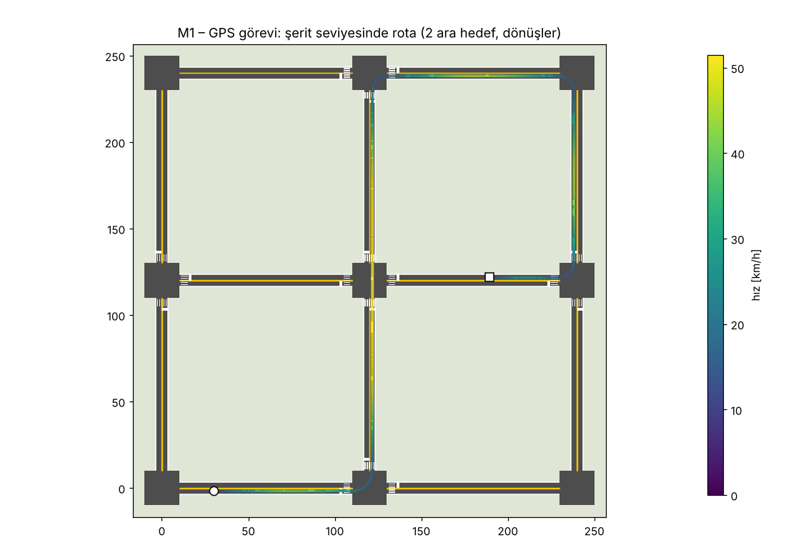
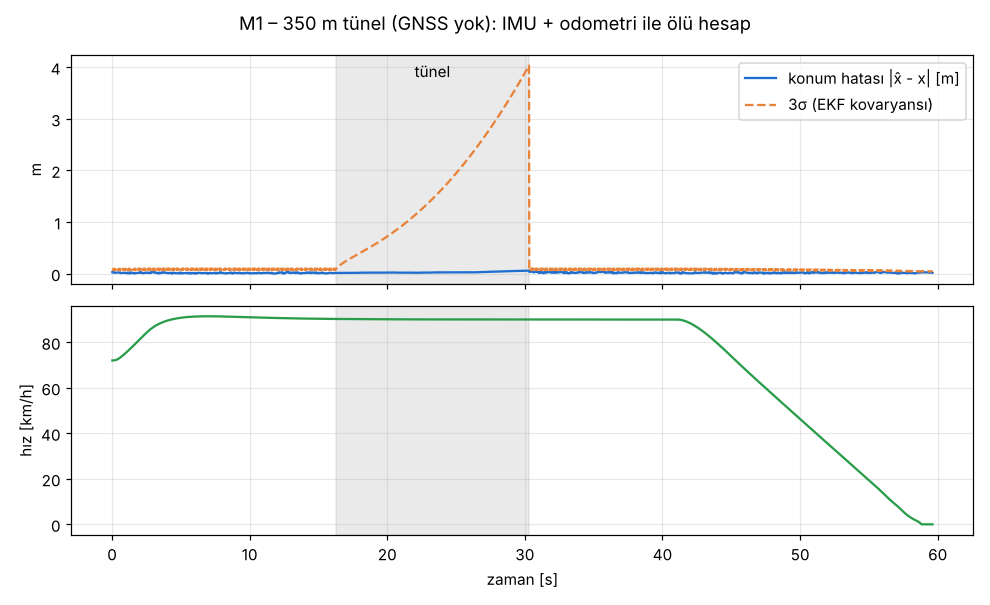

## M2 – Kamera ile şerit algılama ve şerit‑göreli lokalizasyon (tamamlandı)

**Kamera sensör modeli** (`moga/sim/sensors/camera.py`): 400×225 gri tonlu pinhole kamera
(60° FOV, 3° aşağı eğim). Piksel → zemin eşlemesi bir kez hesaplanır; her karede yüzey
rasterı (asfalt/emniyet şeridi/çim/boya: yaya geçidi, stop çizgisi), KD‑ağacındaki şerit
çizgisi örnekleri (kesikli 3 m/6 m, düz, çift sarı) mesafeye bağlı kenar yumuşatmasıyla
çizilir; diğer araçlar ışın‑kutu kesişimiyle şeritleri kapatır (oklüzyon); yağmur/sis
kontrastı düşürür, gürültü ekler; gece modu.

**Şerit algılama** (`moga/autonomy/perception/lane_detection.py`)
1. IPM ile kuş bakışı ızgara (x 4.5–42 m, y ±8 m),
2. mesafeye uyarlanan sırt (koyu‑açık‑koyu) filtresi → çift çizgileri de ayırır,
3. histogram ile başlatma veya takip edilen sınırlardan öngörü,
4. kayan pencereler (çizgi bitince durur – kavşak),
5. sağlam ağırlıklı en küçük kareler ile ikinci derece polinom + katsayı kovaryansı,
6. ego hareketiyle telafi edilen sınır başına Kalman filtresi,
7. çizgi tipi (kesikli / düz / çift) + zamansal oylama, şerit genişliği tutarlılığı.

Doğruluk (10 m'de sınır konumu, yer gerçeğine göre): otoyol **1 cm**, kırsal yol (çift sarı)
**2–3 cm**, yoğun yağmurda **2 cm**.

**Şerit‑göreli lokalizasyon** (`localization/localizer.py`): algılanan şerit merkezine yanal
sapma + bağıl yönelim, EKF'ye haritadaki şerit merkez çizgisine göre ölçüm olarak girer.
Hangi şeridin görüldüğü (veri ilişkilendirme) aday şeritler arasında Mahalanobis mesafesi
ve **çizgi tipi uyumu** (ör. en sol şerit: solda düz, sağda kesikli) ile seçilir; belirsizse
güncelleme yapılmaz. Kavşak içi / kavşak öncesi (çizgisiz) bölgeler dışlanır.

**Fiziksel modelleme düzeltmeleri** (virajlarda 0.3 m hatayı giderdi)
* EKF hareket modeline IMU yanal ivmesinden arka aks **yanal kayma açısı** eklendi,
* Stanley ileri beslemesi yalnızca **ön lastik kayma açısını** ekleyecek şekilde düzeltildi
  (ön aks yön hatası arka kayma açısını zaten içerir) + küçük integral terimi.

**Lokalizasyon hazır kapısı:** şerit seviyesinde konum (yanal σ < 0.35 m) yoksa rota
planlanmaz; araç `LOCALIZING` modunda kamerayla doğrudan şerit takibi yapar.

| Senaryo | İçerik | Sonuç (seed 0) |
|---|---|---|
| `m2_curvy_sps_lane_keep` | Virajlı otoyol, 90 km/h, standart GPS (~1.5 m) | şerit RMS 0.05 m |
| `m2_rural_dgps_fusion` | Kırsal yol, DGPS + çok yollu yansıma | şerit RMS 0.07 m (M1'de 0.3 m) |
| `m2_highway_sps_lane_change` | Standart GPS ile iki şerit değiştirip hedefe | şerit RMS 0.01 m |
| `m2_curvy_long_tunnel` | ~800 m virajlı GNSS kesintisi | şerit maks. 0.12 m |
| `m2_rain_rural` | Yoğun yağmur + DGPS | şerit RMS 0.04 m |

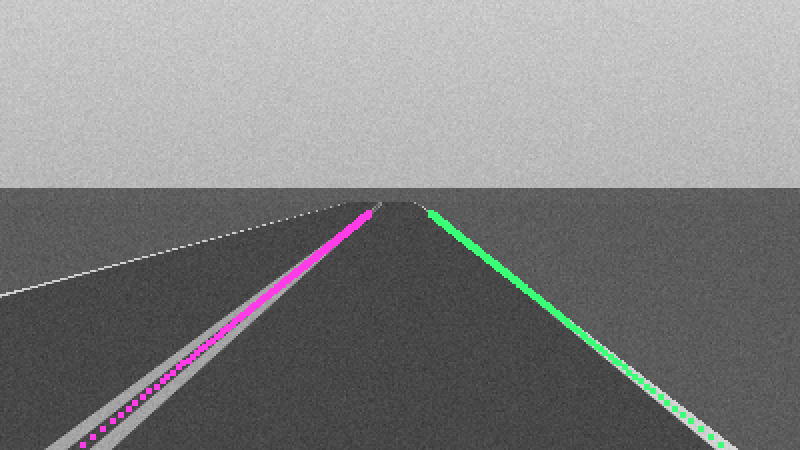
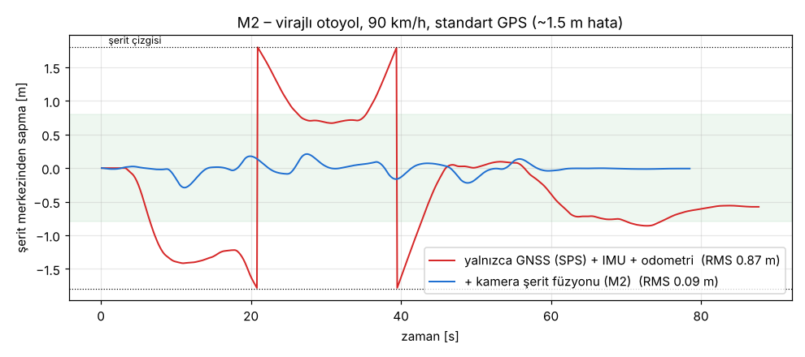

## M3 – LiDAR/radar algılama, çoklu nesne takibi, tahmin, ACC (tamamlandı)

**Sensör modelleri**
* `sim/sensors/lidar.py` – 32 kanallı dönen LiDAR (‑25°…+10°, ufuk çevresinde 0.33° sık
  kanallar, 0.2° azimut, 10 Hz, 150 m):
  zemin düzlemi + araç/yaya/yapı kutularıyla ışın kesişimi (kutunun kapladığı azimut
  sektörüyle sınırlı → ~4 ms/kare), menzil gürültüsü, ışın kaybı, şerit boyası
  yansıtıcılığı, yağmurda menzil düşüşü ve yakın mesafe yağmur gürültüsü.
* `sim/sensors/radar.py` – ön uzun menzilli radar (±45°, 160 m): kutunun en yakın
  noktasından menzil/azimut/Doppler, RCS'ye bağlı tespit olasılığı (yaya zayıf), örtme,
  statik parazit (clutter).

**Algılama** (`autonomy/perception/lidar_detection.py`)
1. RANSAC + en küçük kareler ile zemin düzlemi,
2. HD harita ilgi bölgesi (yol + 5 m kaldırım payı) → yol dışı yapılar elenir,
3. doluluk ızgarası + bağlı bileşen kümeleme,
4. **eğik açıda parçalanan yüzeylerin birleştirilmesi** (kamyon yan yüzü ~1 m aralıklı ışınlar),
5. arama tabanlı **L‑shape kutu uydurma**; tek yüz görülen nesnelerde **harita şerit
   yönü önceli**,
6. ayak izine dayalı sınıflandırma (yükseklik yalnızca yakında güvenilir),
   kısmi görülen araçlar için **amodal tamamlama**, çakışan kutular için NMS.

**Takip** (`autonomy/tracking/tracker.py`): sabit hız Kalman filtresi, Mahalanobis +
Macar algoritması ile ilişkilendirme, sınıf uyumluluğu, M‑of‑N onay, radar Doppler EKF
güncellemesi ve statik parazit reddi, yalnız‑radar aday izler, kopya iz birleştirme.

**Tahmin** (`autonomy/prediction/predictor.py`): şerit üzerindeki araçlar için şerit
grafında dallanan (kavşakta düz/sağ/sol olasılıklı) şerit takibi, şerit değiştirme
algılama, diğerleri için sabit hız.

**ACC / yol verme** (`autonomy/planning/object_reasoning.py`): yol koridorundaki öncü
araç ve yola girecek (kesişen) nesneler; IDM ile takip, duran engel arkasında güvenli durma.

**Algılama kalitesi** (yer gerçeğine göre, gecikme telafili; `m3_highway_perception`):
geri çağırma **0.99**, kesinlik **1.00**, konum RMSE **0.27 m**, hız RMSE **0.48 m/s**,
sınıf doğruluğu **%100**.

| Senaryo | İçerik |
|---|---|
| `m3_highway_perception` | 3 şeritte yoğun trafik (otomobil + tır), algılama kalitesi + ACC |
| `m3_acc_stop_and_go` | Öncü araç yavaşlar, durur, tekrar kalkar |
| `m3_lead_hard_brake` | 90 km/h'te öncü araç 6 m/s² ile acil durur |
| `m3_stopped_vehicle` | Viraj arkasında arızalı araç: güvenli durma |
| `m3_pedestrian_jaywalk` | Yaya yola aniden girer: yol ver, sonra devam et |

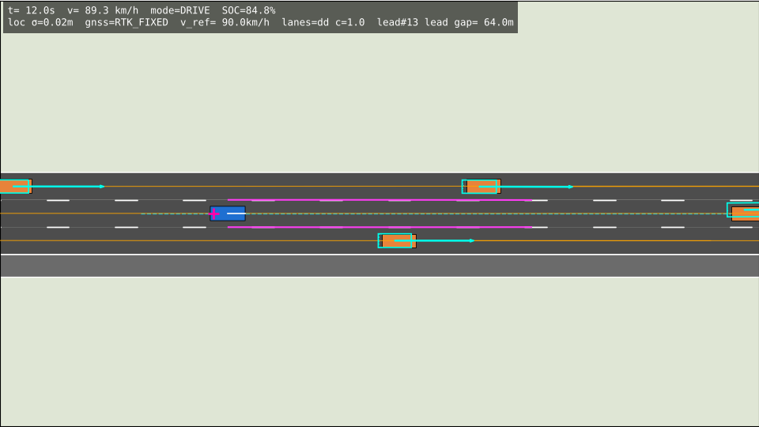
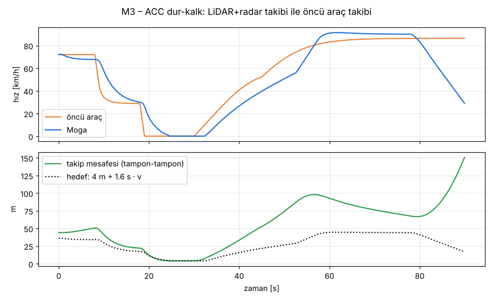

## M4 – Davranış ve hareket planlama (tamamlandı)

Planlama hattı her 0.1 s'de çalışır:
`rota takibi → referans çizgisi → nesne akıl yürütme → davranış (FSM) → Frenet kafes
planlayıcı → yörünge kontrolcüsü`, bunlardan bağımsız olarak **AEB** son savunma hattıdır.

**Taktik planlama** (`autonomy/planning/planner.py`, `reference.py`)
* Rota takibi: şerit seviyesindeki rotada ilerleme, sıradaki zorunlu şerit değişimi
  (yön, kalan mesafe, ardışık değişim sayısı), hedefe kalan mesafe, kapalı pistte tur geçişi.
  Zorunlu değişim yalnızca aciliyet kazandığında (≥ n·max(200 m, 10 s)) devreye girer;
  öncesinde şerit seçimi serbesttir (sollama, sağdan gitme).
* Referans çizgisi: rota tercihli şerit zinciri, eğrilik → yanal ivme limitli hız
  profili + ileriye bakan yavaşlama, komşu şeritler.
* Nesne akıl yürütme: tahmin edilen nesneler referansın Frenet çerçevesine yansıtılır;
  şerit başına öndeki / arkadaki araç boşluğu ve hızı, durağan engel tespiti.

**Davranış katmanı** (`behavior.py`) – durum makinesi
`LANE_KEEP → PREPARE_LC (sinyal, boşluk bekleme) → LANE_CHANGE`, `BLOCKED → BYPASS`.
Şerit değiştirme nedenleri (öncelik sırasıyla): **rota** (zorunlu), **engel**, yavaş öncü
aracı **soldan sollama**, sollamadan sonra **sağa dönüş**. Boşluk kabulü arka/ön araç
mesafesi ve hız farkına göre yapılır (zorunlu değişimlerde gevşetilir).

**Frenet kafes planlayıcı** (`frenet.py`, Werling vd. 2010)
* yanal: hedef ofsetlere 5. derece polinomlar; yüksek hızda zamana, düşük hızda
  (< 4 m/s) yola bağlı `d(s)`,
* boylamsal: hız tutma (4. derece), takip ve durma (5. derece, doğal durma süreleri dahil),
  duruşta "yerinde bekle" adayı,
* önceki planın Frenet durumundan (konum, hız, **ivme**) dikiş (stitching); yola bağlı yanal
  manevrada önceki bitiş noktası aday olarak korunur → yeniden planlama manevrayı ötelemez,
* fizibilite: ivme, eğrilik, yanal ivme, yol sınırları, hız limiti (geç fark edilen duruşlarda
  gereken yavaşlamaya göre uyarlanan durma profili),
* çarpışma: ego ve nesneler daire ayrıştırması, tüm tahmin modları (olasılığa göre sert /
  yumuşak), "zaten yakınsak daha da yaklaşma" kuralı, yol‑zaman (ST) aralık kısıtları
  (sert 1 m + 0.25·v, yumuşak 4 m + 1.6 s·v); arkadan gelen aynı şerit trafiği planı zorlamaz,
* maliyet: sarsıntı, hedef ofset, ideal hız profiline göre eksik, engellere yakınlık,
  konfor üstü fren cezası.

**Yörünge kontrolcüsü** (`control/trajectory_controller.py`): plan üzerinde Stanley (geri
yay uzatmalı), zaman indeksli hız referansı + ivme ileri beslemesi, duruşta fren tutma.

**Engel geçişi (bypass) – iki şeritli yolda karşı şerit kullanımı**
* engelin 8 m gerisinde (yanal manevra için yer bırakarak) durma,
* **boşluk kabulü**: manevra süresi (kalkıştan 1.4 m/s² ile 9 m/s'ye, engeli geçip şeride
  dönene kadar) + 3 s tampon, karşıdan gelen aracın manevra bölgesine varış süresinden kısa
  olmalı; histerezisli ve araç engelin yanına gelene kadar her döngüde yeniden
  değerlendirilir → yeni bir araç görünürse manevra iptal edilip şeride dönülür,
* uzun menzil farkındalığı: LiDAR algılama menzili 120 m; LiDAR'ın göremediği (> 60 m)
  hareketli hedefler için radar konum + Doppler güncellemeli **yalnız‑radar izler** (~160 m).

**Bağımsız AEB** (`safety/aeb.py`): planlayıcıdan bağımsız son savunma. İzlerden ve kısa
menzilde ham LiDAR noktalarından çarpışma süresi + gereken yavaşlama hesaplanır;
yalnızca TTC < 2.5 s **ve** gereken yavaşlama > 5 m/s² iken 8.5 m/s² ile frenler.
Eğrilik sönümlü yol tahmini; bizden hızlı uzaklaşan araçların noktaları yok sayılır
(şerit değiştirirken komşu şeritteki araç yanlış tetikleme yapmaz).

**Tahmin iyileştirmeleri**: virajdaki küçük yön hataları şerit değiştirme sayılmaz (yanal
hız > 1.2 m/s ya da kaymış olup aynı yöne hareket gerekir), şerit değiştirme hedefi komşu
şerit merkeziyle sınırlı; aynı yönde komşu şerit yoksa yalnızca düşük olasılıklı (yumuşak)
hipotez; frenleyen araçlar için sabit yavaşlama; yola yakın yayalar için yola girme hipotezi.

**Simülatör düzeltmesi**: kamera, araç gri tonunu süreç başına rastgele olan `hash()` ile
seçiyordu → sonuçlar `PYTHONHASHSEED`'e bağlıydı. CRC32 ile deterministik hale getirildi;
`tests/test_determinism.py` farklı süreç / hash tohumlarında birebir aynı sonucu doğrular.

| Senaryo | İçerik | min TTC | maks. yavaşlama | Not |
|---|---|---|---|---|
| `m4_overtake_slow_truck` | Sağ şeritte yavaş tır, orta şeritte trafik: boşluk bekle, sola geç, sollama, sağa dön | 7.2 s | 3.2 m/s² | ort. hız ≥ 68 km/h |
| `m4_cut_in` | ~12 m önüne kesip yavaşlayan araç: acil fren olmadan mesafe aç | – | 3.2 m/s² | min. mesafe 7.1 m |
| `m4_static_obstacle_lane_change` | Şeritte arızalı araç, iki komşu şeritte trafik: boşluğa geç, engeli geç | 2.5 s | 5.0 m/s² | |
| `m4_route_lane_changes_traffic` | GPS hedefi sağ şeritte, sağ ve orta şerit yoğun: iki zorunlu şerit değişimi | 11.4 s | 2.8 m/s² | |
| `m4_rural_bypass` | İki şeritli yolda arızalı araç + karşıdan gelen trafik: bekle, boşlukta karşı şeritten geç | 1.6 s | 3.7 m/s² | 15 s bekleme |
| `m4_aeb_occluded_pedestrian` | Park etmiş minibüsün arkasından 17 m önde fırlayan yaya (40 km/h) | – | 8.2 m/s² (AEB) | yayaya mesafe 1.2 m |

Kabul kriterleri: çarpışma yok, hedefe varış, normal manevralarda **acil durma / AEB yok**,
min TTC ≥ 1.5 s, konfor yavaşlaması ≤ 4 m/s² (engel senaryosunda ≤ 5.5 m/s²), yayaya
mesafe > 0.3 m. Regresyon: M0–M4'ün 24 senaryosu + birim testleri yeşil.

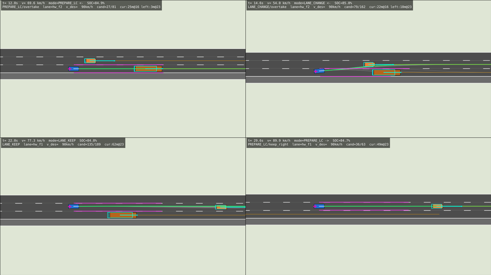
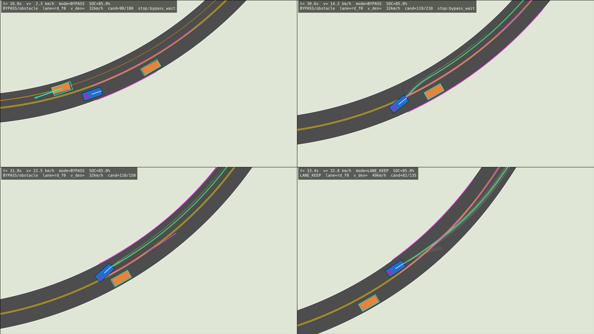
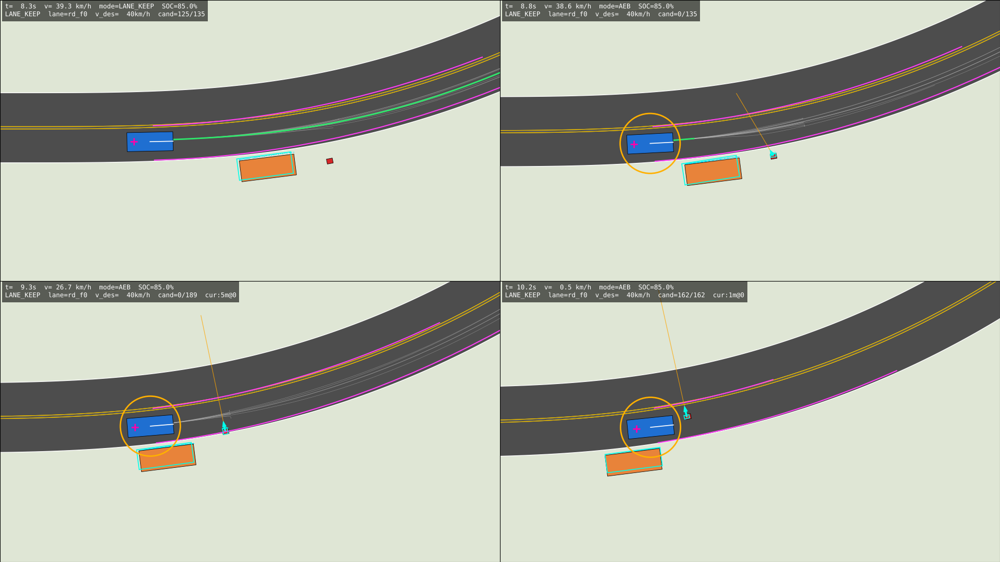

## M5 – Şehir içi sürüş (tamamlandı)

**Trafik ışığı algılama**
* Simülatör (`sim/sensors/traffic_light.py`): kamera + sınıflandırıcının nesne seviyesinde
  modeli – 70° yatay / ‑5°…+25° dikey görüş, 110 m menzil, yalnızca araca bakan ışık başları,
  mesafe ve hava ile düşen tespit olasılığı, diğer araçların görüş hattını kapatması
  (ör. kamyon), %1 "bilinmiyor", %0.2 yanlış renk, mesafeyle büyüyen konum gürültüsü.
  Işık başları kavşağın karşı köşesinde (dur çizgisinde beklerken de görüş alanında).
* Otonomi (`autonomy/perception/traffic_lights.py`): tespitlerin HD harita ışık başlarıyla
  ilişkilendirilmesi (konum kapısı + yön), 0.35 s güven ağırlıklı oylama, tutucu eşitlik
  bozma (kırmızı > sarı > yeşil), 1 s gözlem yoksa `unknown`, durum değişim zamanı.

**Trafik kuralları** (`autonomy/planning/rules.py`) – algılanan sahneyi referans çizgisi
üzerinde durma kısıtlarına ve hız sınırlarına çevirir:
* **Işık**: kırmızıda dur çizgisinde dur; `unknown` ve çizgiye < 60 m ise dur; sarıda
  **ikilem bölgesi** kararı (3 m/s² ile durulabiliyorsa dur; durulamıyor ve çizgi sarı
  süresinde geçilebiliyorsa devam – karar korunur).
* **Yaya geçidi**: geçitte olan / geçide yürüyen yayalara yol ver; kavşak çıkışındaki geçit
  için kavşağa girmeden bekle (kavşağı kilitleme); geçit yakınında yaya ya da sınıflandırılmamış
  küçük nesne varsa geçide 15 km/h ile yaklaş (proaktif yavaşlama).
* **Kavşak yol hakkı**: kavşağı boşaltan çatışan araçlara ve sinyalsiz kavşakta çatışan
  yönden yaklaşan araçlara yol ver (savunmacı: diğerleri önceliklidir), zaman boşluğu kontrolü.
* **Kavşak geçiş hızı**: sinyalize 40 km/h, sinyalsiz 30 km/h.

**Planlayıcı entegrasyonu** (`planning/planner.py`, `frenet.py`)
* Kural duruşları sert kısıttır; hız sınırları mevcut durumdan uygulanabilir yavaşlamayla
  devreye girer. İlerleme referansı (ideal hız profili) duruşlar için 1.8 m/s² ile daha erken
  ve yumuşak frenler (tipik duruşlarda maks. yavaşlama < 2 m/s²).
* **Kuyruk ≠ engel**: dur çizgisine 10 m yakın duran araç ve arkasındaki kuyruk trafiktir
  (sollanmaz, bypass edilmez); kavşaktan uzakta park etmiş araç ise engeldir.
* Kavşak yakınında keyfi şerit değiştirme / bypass yok; bypass manevrası kavşağa uzanamaz.
* **Geçiş önceliği**: araç kavşağın içindeyken (ya da yeşilde girerken) çatışan yaklaşım
  şeritlerindeki araçların – durabilecek durumdaysalar – giriş çizgisinde duracağı varsayılır;
  kavşak ortasında gereksiz acil fren yapılmaz.
* Geçilen (durağan doğrulanmış) engelin izi, görüş açısı değişiminden kaynaklanan sahte hızla
  ileri taşınmaz. Başlangıçtaki hız fazlası (ör. viraj/kavşak sınırına girerken) jerk sınırlı
  rampayla azaltılabilir; fizibilite bu yüzden çökmez.

**Simülatör iyileştirmeleri**: NPC araçlar çapraz / dönen trafiğin işgal ettiği kavşağa girmez;
**yaya geçidi ihlali** metriği (geçitte yaya varken aracın geçitte hareket etmesi) ve kabul
kriteri; konfor metrikleri 0.2 s ortalamalı.

| Senaryo | İçerik | Sonuç |
|---|---|---|
| `m5_red_light_stop_go` | Varışta kırmızı: ışığı algıla, dur çizgisinde dur, yeşilde kalk | maks. yavaşlama 1.8 m/s² |
| `m5_yellow_dilemma` | Çizgiye ~12 m kala sarı → devam; ~46 m kala sarı → dur | ihlal yok, 3.3 m/s² |
| `m5_crosswalk_pedestrians` | Yeşil ışıkta kavşak öncesi ve sonrası geçitlerde yayalar | yayaya ≥ 2.6 m, kavşak kilitlenmez |
| `m5_unsignalized_junction` | Sinyalsiz 4 kollu kavşakta çapraz yoldan iki araç | yol ver, boşlukta geç, TTC ≥ 4.8 s |
| `m5_queue_at_red` | Kırmızıda bekleyen iki aracın arkasında kuyruk, yeşilde takip | bypass / şerit değiştirme yok |
| `m5_urban_mission` | 3×3 sinyalize ızgarada GPS görevi: araç arkasında sola dönüş, çapraz trafikli 4 kollu kavşak, karşı trafikli çift park etmiş minibüs, geçitlerde yayalar, sağa dönüşler, sinyalsiz köşe | 627 m, 178 s, acil durma yok |

Kabul kriterleri: çarpışma yok, kırmızı ışık ihlali yok, yaya geçidi ihlali yok, normal
sürüşte acil durma / AEB yok, konfor yavaşlaması ≤ 3.5–4.5 m/s², senaryoya özgü davranışın
gözlenmesi (`WAIT_LIGHT`, `YIELD_PED`, `YIELD_JUNCTION`, `BYPASS`).
Regresyon: M0–M5'in 30 senaryosu + birim testleri yeşil.

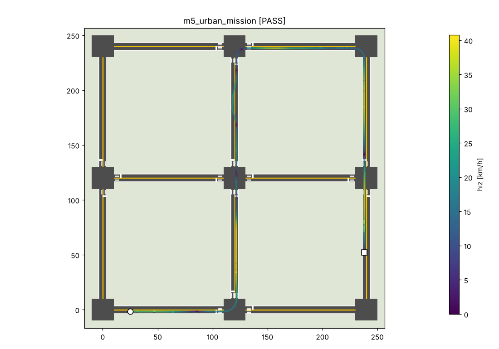
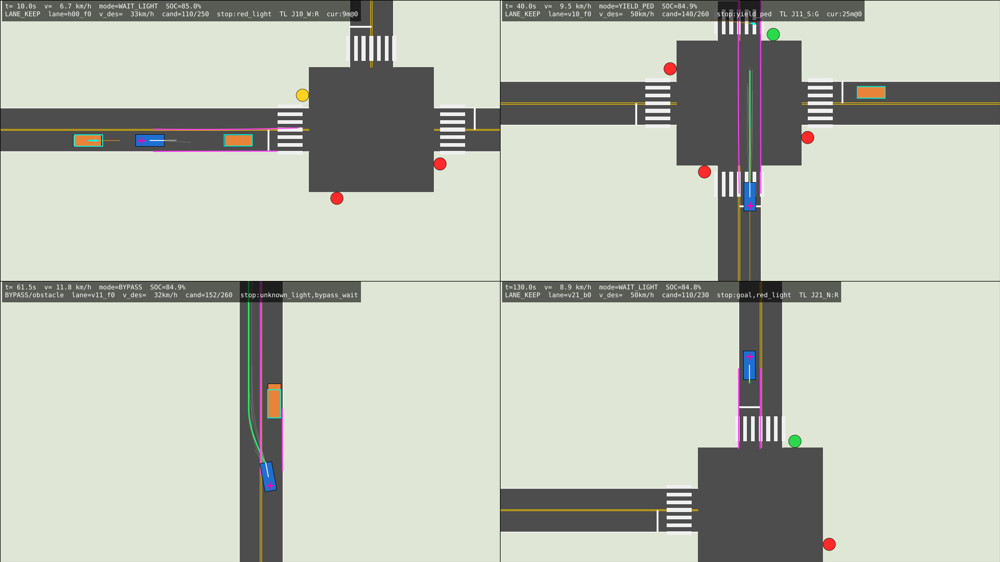
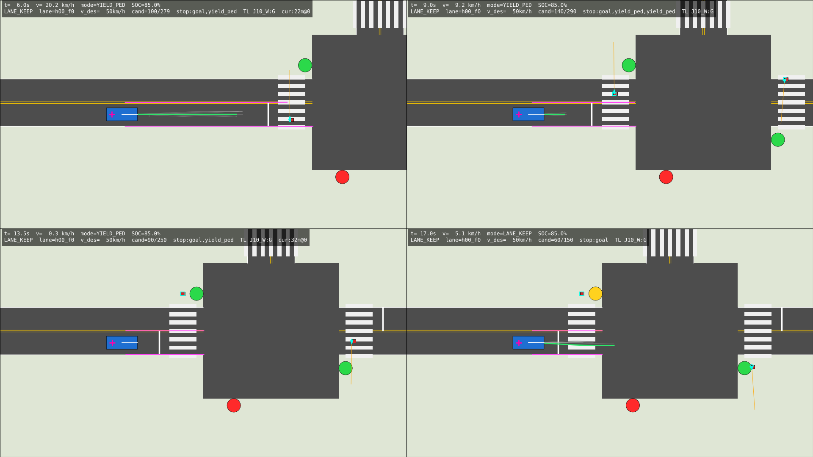
