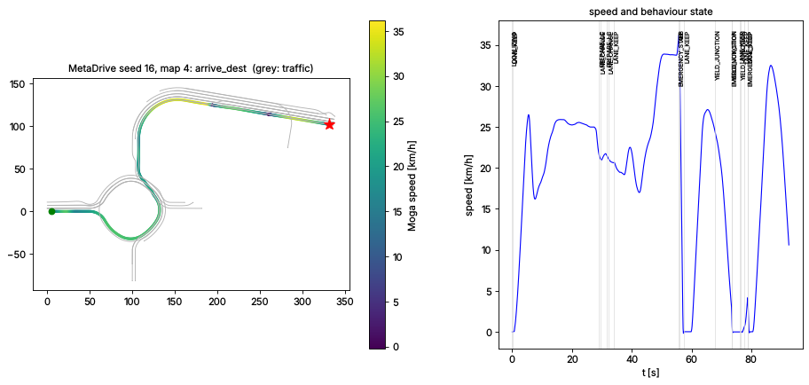

# M7 – Gerçek sensör verisi ve bağımsız simülatör

M0–M6 boyunca yığın yalnızca MogaSim'in sentetik sensörleriyle test edildi.
M7'nin sorusu: **araca gerçek bir LiDAR ve gerçek kameralar takıldığında
sistem çalışır mı?**  Bunun için iki bağımsız doğrulama yapıldı:

1. **Gerçek kayıt (açık çevrim)** – KITTI raw veri setinden gerçek bir
   Velodyne HDL‑64E, kalibre kamera ve OXTS GNSS/INS kaydı, yığının mesaj
   arayüzüne çevrilip algılama zincirinden geçirildi ve insan etiketleriyle
   karşılaştırıldı.
2. **Üçüncü taraf simülatör (kapalı çevrim)** – Moga yığını, araştırmada
   kullanılan açık kaynak **MetaDrive** simülatöründe (Bullet fizik motoru,
   prosedürel yol ağları, IDM trafik, yol kazaları) kendi haritası, kendi
   sensör modelleri ve kendi görev tanımıyla sürdürüldü.  Başarı ölçütü
   MetaDrive'ın kendi ölçütüdür (hedefe varış / çarpışma / yoldan çıkma).

Kısa cevap: **yığın gerçek veriyi aynı arayüzden işler ve işaretli yollarda
iyi sonuç verir; yoğun şehir dokusunda geometrik LiDAR dedektörünün
kesinliği yetersizdir** (aşağıda sayılarla).  Gerçek araçta bir sonraki adım
öğrenmeli (learned) 3B nesne dedektörü ve HD harita tabanlı ilgi bölgesidir.

## 1. Gerçek araca entegrasyon

Yığın yalnızca `moga/common/messages.py` mesajlarını görür.  Gerçek araçta
her sensör sürücüsünün üretmesi gerekenler:

| Mesaj | İçerik | Çerçeve / birim | Hız |
|---|---|---|---|
| `PointCloud` | noktalar, yoğunluk, halka, **nokta başına zaman farkı** (`time_offset`) | `base_link`, m | 10 Hz |
| `CameraImage` | gri görüntü + `ProjectiveCamera` (P, `T_cam_vehicle`, K, bozulma) | doğrultulmuş görüntü | 10–30 Hz |
| `ImuMeasurement` | özgül kuvvet, açısal hız | gövde, m/s², rad/s | 50–100 Hz |
| `WheelOdometry` | teker hızı, ölçülen tekerlek açısı | m/s, rad | 50 Hz |
| `GnssFix` | WGS‑84, fix tipi, alıcının bildirdiği σ, Doppler hız | derece, m | 10 Hz |
| `VehicleStatus` | SOC, direksiyon açısı, hız, yağmur sensörü | – | 50 Hz |

* **Kalibrasyon**: `common/calibration.py` – araç başına bir `SensorRig`
  JSON dosyası: LiDAR/IMU dış parametreleri (`T_vehicle_*`), kameralar
  (`P`, `T_cam_vehicle`, ham lens için `K` + Brown‑Conrady bozulma katsayıları,
  `undistort()`), GNSS anten kolu, LiDAR dönüş süresi/yönü ve **gövde kutusu**
  (`body_box`: tavan taşıyıcısı, aynalar gibi kendi gövdesinden gelen dönüşler).
* **LiDAR**: dönen LiDAR'da bir tarama 0.1 s sürer (90 km/h'te 2.5 m yol);
  `perception/deskew.py` noktaları araç hareketiyle tarama zamanına taşır.
  `LidarDetectorConfig.for_rig(rig)` gerçek sensör ayarlarını verir (gövde
  filtresi, 0.1 m voksel ızgara, de‑skew).
* **Takılı sensör kümesi**: `StackConfig.sensors` – yalnızca takılı sensörler
  sağlık izleyicide denetlenir (ör. kamerasız / radarsız bir platform).
* **Araç parametreleri**: `common/vehicle_params.py` (aks mesafesi, direksiyon
  ve fren aktüatör dinamiği, gövde ölçüleri) gerçek ölçümlerle doldurulmalı.

## 2. Gerçek kayıt: KITTI raw (açık çevrim)

```bash
# veri: http://www.cvlibs.net/datasets/kitti/raw_data.php (CC BY-NC-SA 3.0, repoya eklenmez)
python scripts/replay_kitti.py --root /data/kitti --drives 5 15 \
    --configs sim_defaults real_rig real_rig_shape_checks real_rig_zones --figures 150 --out out/kitti
```

* **Veri**: 2011_09_26 sürüş 0005 (şehir içi dar sokak: park etmiş araçlar,
  bisikletliler, ağaçlar, direkler; 154 tarama) ve 0015 (iki yönlü yol,
  trafikte araçlar; 297 tarama).  Velodyne HDL‑64E ≈ 123 000 nokta/tarama.
  Okuyucu: `io/kitti.py` (zip dosyalarından doğrudan okur; `base_link` = IMU
  izdüşümü, zemin z = 0).
* **Yöntem** (`eval/replay.py`): algılama izole ölçülsün diye ego poz INS'ten
  alınır.  KITTI yalnızca kamera görüş alanını etiketlediği için değerlendirme
  bölgesi ön kameranın görüş alanı (±38°, 40 m); çok örtülü / kesik nesneler
  "önemsiz" (ne kaçırma ne yanlış pozitif).  BEV merkez mesafesiyle Macar
  eşleştirmesi (araç 2.0 m, bisikletli 1.5 m, yaya 1.0 m).  İki bölge:
  **görüş alanı** ve sürüş için asıl önemli olan **koridor** (±4 m: kendi ve
  komşu şerit).  HD harita yok → dedektör haritasız kipte çalışır.

### LiDAR nesne algılama ve takip

`sim_defaults` = MogaSim için ayarlanmış dedektör olduğu gibi;
`real_rig` = M7 gerçek sensör ayarları (gövde filtresi, voksel, de‑skew,
haritasız ego‑yol önceli).  R = geri çağırma (recall), P = kesinlik.

| Sürüş | Ayar | Bölge | Algılama R / P | Sınıf doğr. | Konum hatası (medyan / p90) | Yön hatası | İz R / P |
|---|---|---|---|---|---|---|---|
| 0015 yol | sim_defaults | koridor | 0.87 / 0.60 | 0.57 | 1.73 / 1.94 m | 81.8° | 0.89 / 0.60 |
| 0015 yol | **real_rig** | koridor | **0.94 / 0.61** | **1.00** | **0.21 / 0.58 m** | **3.3°** | **0.94 / 0.63** |
| 0015 yol | real_rig | görüş alanı | 0.74 / 0.30 | 0.95 | 0.21 m | 3.3° | 0.75 / 0.27 |
| 0005 şehir | sim_defaults | koridor | 0.69 / 0.29 | 0.91 | 0.15 m | 3.1° | 0.75 / 0.26 |
| 0005 şehir | **real_rig** | koridor | **0.72 / 0.30** | 0.89 | 0.18 / 1.21 m | 3.1° | **0.81 / 0.28** |
| 0005 şehir | real_rig | görüş alanı | 0.66 / 0.23 | 0.86 | 0.27 m | 3.2° | 0.78 / 0.23 |

Sınıf bazında (real_rig, görüş alanı): 0015 araç 0.78 (552 etiket), bisikletli
0.38 (61); 0005 araç 0.67 (287), bisikletli 0.64 (154), yaya 0.44 (9).

Seçenekler (her ikisi de varsayılan olarak kapalı):

| Ayar | 0015 koridor R / P | 0005 koridor R / P | Not |
|---|---|---|---|
| `shape_checks` (bitki örtüsü / direk reddi) | 0.94 / 0.65 | 0.68 / 0.33 | kesinlik ↑, şehirde araç geri çağırma ↓ |
| `ground="zones"` (bölgesel zemin) | 0.90 / 0.57 | 0.72 / 0.27 | KITTI yolları düz; eğimli yolda fark yaratır (birim testi: %6 eğimde 13 → 0 yanlış nesne) |

**Hesap süresi** (tek çekirdek, saf Python): real_rig 75 ms (0015) –
107 ms (0005) / tarama (p95 98–152 ms).  Başlangıçta 380 ms idi; yağış
filtresinin vektörleştirilmesi (≈12×), voksel ızgara, alt örneklemeli
L‑shape ve RANSAC ile 3.5× hızlandı.  10 Hz LiDAR için sınırda: üretim
sürümü C++/GPU'ya taşınmalı.

**Gerçek veride bulunan ve düzeltilen sorunlar** (simülasyonda görünmüyordu):

* Aracın kendi gövdesinden (tavan taşıyıcısı, sağ ayna) sürekli dönüşler →
  yaya / nesne sanılıyordu → `body_box` filtresi.
* Haritasız kipte, yalnızca arka yüzü görünen önümüzdeki araç (1.8 m genişlik,
  derinlik yok) uzun ekseni yanal sanıldığı için **bisikletli** olarak
  sınıflanıyor ve kutusu yan yatıyordu (yön hatası 82°) → ego yolu yön önceli
  (`mapless_prior_lateral`): ego yolunun yakınındaki kümeler yol yönünde
  kabul edilir; 0015'te sınıf doğruluğu 0.55 → 0.95, konum hatası 1.72 → 0.21 m.
* ~1 m'lik bollard'lar yaya sanılıyordu → yakın mesafede yaya için gözlenen
  yükseklik ≥ 1.2 m.
* 123 bin noktalık bulutta Python döngülü yağış filtresi 150 ms sürüyordu.

**Kalan açık – asıl risk**: şehir dokusunda (0005) yol kenarındaki ağaçlar,
çalılar, direkler, park etmiş bisikletler ve bina cepheleri geometrik
kümeleyiciyle araçlardan / yayalardan ayrılamıyor: koridorda bile kesinlik
%30.  MogaSim'de bu sorun HD harita ilgi bölgesi (yol + 5 m) ile çözülüyordu;
KITTI'de harita yok.  Gerçek araç için:
1. öğrenmeli LiDAR dedektörü (PointPillars / CenterPoint sınıfı) + kamera
   dedektörü (geometrik dedektör yedek / bağımsız kanal olarak kalır),
2. HD harita ilgi bölgesi (ODD zaten haritalı yollarla sınırlı),
3. Moga'nın kendi kayıtlarıyla etiketli bir doğrulama seti.

### Kamera şerit algılama

| Sürüş | İki sınır | Tek sınır | Şerit genişliği (medyan / IQR) | Kareler arası ofset titreşimi | Süre |
|---|---|---|---|---|---|
| 0015 (işaretli yol) | **%100** | %0 | 4.05 m / 0.71 m | **0.8 cm** | 8 ms |
| 0005 (işaretsiz sokak) | %15 | %69 | 4.67 m / 1.24 m | 15 cm | 6 ms |

Simülasyonda geliştirilen IPM + sırt filtresi + polinom zinciri, gerçek
kalibre kamerada işaretli yolda kararlı çalışıyor.  İşaretsiz sokakta
bordür / gölge kenarlarını şerit sanabiliyor; lokalizasyon füzyonu bu
ölçümleri harita tutarlılığı (NIS kapısı) ile eler, ancak işaretsiz yollar
kamera şerit kanalı için ODD dışıdır.

## 3. Bağımsız simülatör: MetaDrive (kapalı çevrim)

[MetaDrive](https://github.com/metadriverse/metadrive) (Apache‑2.0) otonom
sürüş araştırmalarında kullanılan açık kaynak bir simülatördür: Bullet araç
dinamiği, prosedürel yol ağları (düz, viraj, giriş / çıkış rampası, kavşak,
T kavşak), şerit değiştiren IDM trafiği, yol kazaları (arızalı araç, koni,
uyarı üçgeni) ve kendi bitiş ölçütleri.  Hiçbiri Moga için yazılmadığından
araç modeli, trafik davranışı ve yol tasarımı bakımından MogaSim'den
bağımsız bir testtir.  GPU gerektirmez.

```bash
python3.11 -m venv .venv-metadrive && .venv-metadrive/bin/pip install -r requirements-metadrive.txt
.venv-metadrive/bin/python scripts/run_metadrive.py --seeds 0 1 2 3 --map 3 --density 0.1 --plot --out out/metadrive
```

**Köprü** (`bridges/metadrive.py`), her 20 ms fizik adımında:

* **Harita**: MetaDrive yol ağı bir kez Moga `HDMap`'ine çevrilir (merkez
  çizgileri, genişlik, çizgi tipleri – sarı orta çizgi `DOUBLE_SOLID`, komşular,
  ardıllar, kavşak bağlayıcıları ve dönüş yönleri).  MetaDrive'ın 2B çerçevesi
  aynalıdır (y sağa); Moga sağ elli ENU kullanır: `y → −y`, `yaw → −yaw`.
* **Sensörler**: GNSS (RTK modeli, WGS‑84), IMU ve teker odometrisi Moga'nın
  hata modelleriyle MetaDrive aracının gerçek hareketinden üretilir; 32 ışınlı
  LiDAR ışınları MetaDrive'ın Bullet fizik dünyasına (araçlar, trafik nesneleri)
  ve zemine atılır.  Kamera, radar ve trafik ışığı yok (PG haritalarında ışık
  yok) → `StackConfig.sensors = imu, wheel, gnss, lidar`.
* **Görev**: MetaDrive'ın atadığı varış noktası yığına **yalnızca bir GNSS
  koordinatı** olarak verilir; rota yığının kendi rota planlayıcısıyla bulunur.
* **Aktüasyon**: yığının DBW komutu (tekerlek açısı, ivme) aktüatör dinamiği
  (direksiyon gecikmesi / hız sınırı, ivme gecikmesi) ve kalibre gaz/fren
  haritası + integral düzeltme ile MetaDrive'ın normalize `[direksiyon,
  gaz_fren]` girdisine çevrilir.  Araç parametreleri MetaDrive aracınınkidir
  (`METADRIVE_VEHICLE`: aks mesafesi 2.47 m, 40° direksiyon).

### Sonuçlar

24 bölüm, her biri farklı bir prosedürel yol ağında (rastgele bloklar: düz,
viraj, giriş / çıkış rampası, dört yollu kavşak, T kavşak, döner kavşak),
MetaDrive IDM trafiğiyle; sonuç MetaDrive'ın kendi bitiş ölçütüdür.

| Set | Harita | Trafik yoğunluğu | Kaza | Hedefe varış | Çarpışma | Yoldan çıkma | Toplam yol | Ort. hız | AEB'li bölüm |
|---|---|---|---|---|---|---|---|---|---|
| A (seed 0–7) | 3 blok | 0.10 | – | **8/8** | 0 | 0 | 2.6 km | 22 km/h | 1 |
| B (seed 10–17) | 4 blok | 0.15 | – | **8/8** | 0 | 0 | 3.1 km | 19 km/h | 3 |
| C (seed 20–27) | 3 blok | 0.10 | her blokta (arızalı araç, koni, üçgen) | **7/8** | 1 | 0 | 2.4 km | 20 km/h | 1 |
| **Toplam** | | | | **23/24** | 1 | 0 | **8.0 km** | | 5 |

* Hiçbir bölümde güvenlik denetçisi `NOMINAL` dışına çıkmadı (sensör / lokalizasyon
  sorunu yok); yollarda şerit değiştirme, rampalardan katılma, kavşakta yol verme ve
  döner kavşak geçişi yapıldı.
* **Çarpışma (C, seed 22)**: Moga aracı kendi şeridinde, kavşak girişinin 1.6 m
  gerisinde yol veriyordu (0.06 m/s); kavşaktan sola dönen bir MetaDrive trafik
  aracı bağlayıcı şeridinden 1.15 m sapıp köşeyi keserek duran araca çarptı.
  MetaDrive ölçütüyle başarısız sayılır; Moga'nın hatalı bir hareketi yok, ancak
  bu tür bir saldırgan / hatalı dönüşe karşı (duran araçla) yapılabilecek bir
  kaçınma da yok.
* **Sert fren**: 24 bölümün 8'inde > 4 m/s² yavaşlama (5'inde AEB) oldu.  Hepsi
  işaretsiz kavşaklarda ya da yan yoldan kesen trafikte: yol verme kararı geç
  geldiğinde planlayıcı acil durma seçiyor (en yakın mesafe 0.30 m, seed 25).
* Bölüm başına hesap süresi ≈ 1–3 dk (LiDAR ışın izleme + yığın, tek çekirdek).



**MetaDrive'ın bulduğu yığın hataları** (MogaSim'in uzun yol segmentlerinde
ortaya çıkmayan; düzeltildi ve MogaSim regresyonu yeşil):

* Kısa yol segmentlerinde şerit değişimi segment sınırını geçince hedef
  şeride varış algılanmıyor, ikinci bir şerit değişimi başlıyordu → aracın
  beyaz düz çizgiye değmesi (MetaDrive: yoldan çıkma).  Varış artık hedef
  şeridin devamında da tanınıyor.
* Şerit değişimi sırasında hedef şerit bittiğinde (şerit düşmesi) planlayıcı
  çöküyordu (`KeyError`).  Şerit değişimi iptal edilip mevcut şeritte devam
  ediliyor.
* MetaDrive kavşaklarında bağlayıcılar da yan yana şerit grubudur; rota için
  gereken şerit değişimi kavşak içinde 0.5 s'de bir başlayıp iptal ediliyordu
  (salınım).  Kavşak içinde şerit değişimi başlatılmıyor, girerken süren
  değişim sonlandırılıyor.
* Şerit değişimi ortasında segment sonuna gelindiğinde ardıl şerit rota
  dışından seçilebiliyordu (T kavşakta yanlış kola girip harita dışına çıkma
  → ODD dışı → MRM/MRC).  Ardıl seçiminde rotanın yolu tercih ediliyor.
* İşaretsiz kavşakta karşı araca yol verme kararı sabit 4 s varsayımıyla
  veriliyordu; MetaDrive'ın 40 m'lik bağlayıcılarında araç hâlâ kavşaktayken
  kararı geç veriyordu.  Artık diğer aracın kavşaktan çıkış süresi kullanılıyor.

**Köprüde çözülen simülatör farkları**: frenli duran Bullet aracı adımdan
adıma ±0.1 m/s titreşir ve sert frende geriye kayar (teker odometrisi ve
yön kestirimini bozuyordu) → iki adımlık hız ortalaması ve ~2 m/s²'lik
duruş freni.

**Açık kalan gözlemler**: işaretsiz büyük kavşaklarda dönmekte olan araçların
tahmini (sabit hız) hâlâ geç / sert frenlemeye (birkaç bölümde acil durma)
yol açabiliyor; MetaDrive IDM trafiği yol vermediği için bazı bölümlerde
AEB devreye giriyor.  Kavşakta çok kipli (dönüş) tahmin bir sonraki
iyileştirme adımıdır.

## 4. CARLA

CARLA (Unreal Engine, GPU gerektirir) denendi ancak bu geliştirme ortamının
ağ politikası indirme adreslerini (`carla-releases.s3.us-east-005.backblazeb2.com`,
`tiny.carla.org`, GitHub sürüm dosyaları) engelliyor (HTTP 403); ortamda GPU da
yok.  MetaDrive köprüsündeki yapı (harita dönüştürücü, sensör modelleri,
DBW) CARLA'ya aynen taşınabilir; CARLA için ek olarak OpenDRIVE → `HDMap`
dönüştürücüsü ve CARLA'nın kendi LiDAR / kamera sensörlerinin mesaj
eşlemesi gerekir.  Ağ erişimi açık ve GPU'lu bir makinede bu adım
uygulanabilir.

## 5. Sonraki adımlar (gerçek araç)

1. Moga sensör takımının kalibrasyonu → `SensorRig` JSON; zaman senkronizasyonu (PTP).
2. ROS 2 sürücüleri ↔ Moga mesajları köprüsü ve kayıt (rosbag2) okuyucu.
3. Öğrenmeli LiDAR + kamera nesne dedektörü; Moga kayıtlarıyla etiketli doğrulama seti.
4. Algılama zincirinin C++'a taşınması (10 Hz gerçek zaman payı).
5. Kavşakta çok kipli tahmin; MetaDrive'da daha yoğun trafik ve rastgele haritalarla
   sürekli regresyon.
